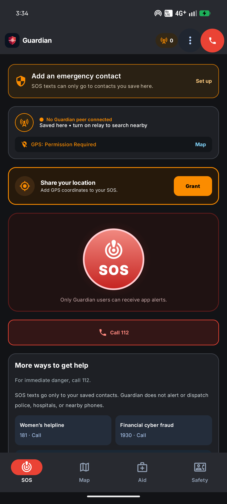

# Guardian

**Prepared to act when help is still on the way.** Guardian is an Android emergency-support app that brings SOS messaging, an offline India map, offline first-aid guidance, and practical rescue tools into one place.



> **Hackathon track:** Best Open-Source AI Project · This build runs Gemma 3 1B IT on device.

## The problem

In a crisis, people may have to act with limited connectivity, share their location quickly, and decide what to do next. Essential actions can be scattered across different apps and tools, adding friction when time and clear information matter.

## The project

Guardian is an offline-first Android toolkit for personal safety, medical emergencies, and disasters. It helps users contact people they trust, understand their position without mobile data, and access emergency guidance and signaling tools from one app.

## How Guardian helps

- **SOS to trusted contacts:** Save the incident and submit a location-aware SMS to selected emergency contacts.
- **India offline map:** View the bundled OpenStreetMap-based map and the phone’s GPS position without an internet connection.
- **On-device AI guidance:** Ask emergency-focused questions with the bundled Gemma 3 1B model; curated first-aid guidance remains available offline.
- **Rescue tools in one place:** Siren, Morse audio, Torch SOS, Floodlight, Medical ID, Compass HUD, nearby relay, and emergency contacts.
- **Nearby Guardian relay:** Discover and relay messages to nearby phones running Guardian when both devices have relay enabled and required radios and permissions are available.
- **Quick access to help:** Keep India’s 112 emergency number within reach.

Guardian complements emergency services: it gives people practical tools to use while seeking help. It does not claim to dispatch responders.

## Example scenario

During a flood with mobile data unavailable, a user can open Guardian’s offline map to check their GPS position, send an SOS and location by SMS to saved contacts when cellular SMS is available, and consult offline guidance. They can also use a torch or Morse signal to attract attention and call 112 for emergency response.

## Demo flow

1. Open the SOS screen and show the saved emergency contact setup.
2. With prior consent from a test contact, submit one demo SOS and show the app’s SMS submission status. Android submission does not confirm carrier delivery.
3. Turn off Wi-Fi and mobile data; open the India map and show the GPS position.
4. Ask the offline AID chat an emergency question and show that the response is generated on device.
5. Demonstrate a rescue signal such as Morse audio or Torch SOS.
6. Explain how Nearby relay works between Guardian phones.

Use only a test contact who has agreed in advance, tell them before sending, and include “DEMO” in the incident details. Do not call 112 or send an SOS to an unsuspecting person during the presentation.

## Download the Android test build

[Download Guardian 1.0.0 for Android testing](https://github.com/polikeybhuvan/Guardian/releases/download/v1.0.0-test/Guardian-Android-Test-1.0.0.apk)

This debug/test APK bundles the Gemma model and India offline map, so the download is about 1.57 GiB and the phone needs additional free storage during installation and first map setup. It is intended for testing and demos, not as a Play Store production release. Review and grant only the Android permissions you want Guardian to use.

## Build and run

### Requirements

- Android Studio with Android SDK Platform 36 (API 36.1)
- JDK 25, matching the Gradle daemon JVM configured for this project
- Git LFS to retrieve the bundled offline map and Gemma model
- Android device or emulator running Android 7.0 (API 24) or newer

### Clone

```bash
git lfs install
git clone https://github.com/polikeybhuvan/Guardian.git
cd Guardian
git lfs pull
```

The India map and Gemma model are stored with Git LFS. A full checkout downloads about 2.2 GB of large assets; allow enough time, data, and disk space. The app’s offline map and on-device AI require these files.

Open the `Guardian` folder in Android Studio, allow Gradle sync to finish, choose the `app` run configuration, and run it on a device.

On Windows, the equivalent commands are:

```powershell
git lfs install
git clone https://github.com/polikeybhuvan/Guardian.git
Set-Location Guardian
git lfs pull
```

The India map is copied from the app assets into private app storage when the map screen is first opened. Allow the initial copy to complete and keep sufficient free storage for the bundled map and its installed copy. The Gemma model is included with the app and is prepared for local use; first-run initialization can take time on some phones.

### Build from the command line

```bash
./gradlew assembleDebug
```

Windows PowerShell:

```powershell
.\gradlew.bat assembleDebug
```

The debug APK is written to `app/build/outputs/apk/debug/`.

## Technology

- Kotlin and Jetpack Compose
- Android location, SMS, camera torch, audio, sensors, and permissions APIs
- Room for local data
- Mapsforge with OpenStreetMap map data for offline mapping
- LiteRT-LM with Gemma 3 1B IT for on-device language-model inference
- Google Nearby Connections for phone-to-phone relay

## Privacy and safety

- SOS-note triage uses local emergency rules; AID chat runs with the bundled Gemma model. No Gemini API key or cloud AI call is required.
- Emergency contacts, Medical ID, and SOS history stay in local app storage; Android app backup is disabled.
- SOS messages go to contacts the user has saved.
- Location and SMS actions depend on device permissions, GPS, SIM, cellular service, and carrier support.
- Nearby relay is for Guardian devices with compatible radios, permissions, and relay enabled.
- Offline first-aid and AI guidance are informational; contact emergency services for urgent assistance.
- In India, call **112** for immediate emergency response.

## Project links

- **Builder’s LinkedIn selection announcement:** [View post](https://lnkd.in/p/dWxtn-v5)
- **India emergency response system:** [112.gov.in](https://112.gov.in/)
- **Gemma model:** [Gemma 3 1B IT on Hugging Face](https://huggingface.co/litert-community/Gemma3-1B-IT)

## Data and model acknowledgements

- Map data © [OpenStreetMap contributors](https://www.openstreetmap.org/copyright), distributed under the [Open Database License (ODbL)](https://opendatacommons.org/licenses/odbl/).
- The bundled Gemma 3 1B IT model is provided under the [Gemma Terms of Use](https://ai.google.dev/gemma/terms) and [Prohibited Use Policy](https://ai.google.dev/gemma/prohibited_use_policy). The required notices are included in `app/src/main/assets/`.

See [THIRD_PARTY_NOTICES.md](THIRD_PARTY_NOTICES.md) for asset acknowledgements and [docs/HACKATHON.md](docs/HACKATHON.md) for the project pitch and demo notes.

## Contributing

Contributions that improve clarity, accessibility, reliability, localization, and emergency preparedness are welcome. Read [CONTRIBUTING.md](CONTRIBUTING.md) before opening an issue or pull request.

## License

Guardian’s original source code is licensed under Apache-2.0. Bundled map data, the Gemma model, and dependencies are subject to their own terms; see [THIRD_PARTY_NOTICES.md](THIRD_PARTY_NOTICES.md).
